<div align="center">


# Sinistro Auto

**Case de UX/UI e front-end: gestão de sinistros de automóvel para uma seguradora, do aviso ao pagamento.**


[Ver o protótipo](https://fernandopinhel.github.io/prototipo-GSRE/) ·
[Como rodar](#como-rodar-localmente) ·
[O case](#o-case)


</div>

> **Este é um case de portfólio.** O projeto nasceu entre 2020 e 2021, numa empresa onde
> trabalhei, como protótipo do módulo de sinistros de automóvel de um sistema de gestão de
> sinistros de ramos elementares (o GSRE do nome do repositório). Ele foi recriado aqui para
> mostrar o processo e o resultado. Para preservar a empresa e o cliente, a interface usa a
> seguradora fictícia **Travessia Seguros**. Segurados, apólices, placas, chassis, oficinas,
> CPFs, CNPJs e valores são todos de exemplo, e nada do que você digita sai do seu navegador.

---

## Sumário

- [O case](#o-case)
  - [Contexto e problema](#contexto-e-problema)
  - [Objetivo](#objetivo)
  - [Decisões de design](#decisões-de-design)
  - [A marca fictícia](#a-marca-fictícia)
  - [Revisitando o case](#revisitando-o-case)
- [A jornada, tela a tela](#a-jornada-tela-a-tela)
- [O que funciona no protótipo](#o-que-funciona-no-protótipo)
- [Acessibilidade](#acessibilidade)
- [Tecnologias e arquitetura](#tecnologias-e-arquitetura)
- [Como rodar localmente](#como-rodar-localmente)
- [Publicação no GitHub Pages](#publicação-no-github-pages)
- [Segurança e privacidade](#segurança-e-privacidade)
- [Limitações](#limitações)
- [Próximos passos](#próximos-passos)
- [Histórico](#histórico)
- [Autor](#autor)

---

## O case

### Contexto e problema

Quando alguém bate o carro, liga para a seguradora querendo saber três coisas: se está
coberto, quando o carro volta e quanto vai pagar. Do outro lado, um time de analistas
trata centenas de processos ao mesmo tempo, cada um numa etapa diferente: esperando
documento, esperando orçamento da oficina, em reparo, esperando nota fiscal, esperando
pagamento.

No sistema antigo, o trabalho do analista era espalhado:

- cada pessoa escolhia na mão qual processo abrir, e os casos difíceis ficavam para depois;
- não havia um prazo visível por etapa, então os atrasos só apareciam na reclamação do segurado;
- orçamento, indenização, documentos e pareceres ficavam em telas soltas, sem o saldo da cobertura à vista;
- quem pedia um pagamento muitas vezes era quem liberava;
- o ressarcimento, a cobrança do terceiro que causou o acidente, dependia de alguém lembrar.

### Objetivo

Desenhar a ferramenta de trabalho do time de sinistros de automóvel, em que:

1. o **aviso** começa pela apólice, que é conferida antes de qualquer outra coisa;
2. a **distribuição automática** entrega o próximo processo a quem está livre, numa ordem que a supervisão define;
3. o **processo** reúne num lugar só a ocorrência, as coberturas, os pareceres, os orçamentos, as indenizações, os documentos e as cartas;
4. o **pagamento** passa sempre por uma segunda pessoa, com alçada para o valor;
5. o **ressarcimento** começa sozinho quando o terceiro foi o culpado;
6. a gestão enxerga o **tempo de cada etapa** e onde a fila está travando.

### Decisões de design

| Decisão | Por quê |
| --- | --- |
| **Barra de operações** no topo, escura, no lugar do menu lateral | O analista passa o dia dentro do processo. A barra ocupa pouco espaço, deixa a ficha larga e mantém à vista o que ele mais usa: a caixa com o contador, a busca rápida e o "Novo aviso". |
| **Busca rápida** por placa, sinistro ou CPF em todas as telas | No telefone, o segurado fala a placa ou o CPF, não o número do processo. A busca leva direto para a consulta já filtrada. |
| **Placa no padrão Mercosul** em listas e fichas | A placa é como o time reconhece um carro. Desenhada como a placa real, ela se destaca no meio de números de sinistro, aviso e apólice. |
| **Jornada do sinistro** como uma estrada com paradas | Aviso, documentos, orçamento, reparo, pagamento e encerramento, com a data de cada parada. Em um segundo dá para saber onde o processo está e o que falta. |
| **Ficha do processo** com coluna lateral fixa | Situação, prazo, responsável, saldo da cobertura e as ações ficam sempre visíveis, enquanto as abas mudam o conteúdo ao lado. |
| **"Pegar o próximo processo"** no lugar de uma lista para escolher | Quando cada pessoa escolhe, os casos difíceis envelhecem na fila. A distribuição entrega o primeiro da ordem, e a ordem é uma decisão da supervisão, não de quem está com pressa. |
| A tela mostra **por que** cada processo está naquela posição da fila | "News: novos documentos", "Vistoria prioritária", "Posição Em análise". Regra que ninguém entende vira desconfiança. |
| **Prazo máximo na caixa**, com justificativa | Um processo distribuído e esquecido volta para a fila, e a pessoa conta o que aconteceu. A supervisão ajusta a distribuição com informação, não com bronca. |
| **Prazo por posição** em todas as listas | "Vence hoje" e "Prazo estourado" aparecem na caixa, na consulta e no início. O atraso fica visível antes de virar reclamação. |
| **Aviso começa pela apólice**, com busca por placa, CPF ou nome | É o que o segurado sabe dizer no telefone. A vigência, o prêmio pendente e os processos abertos aparecem antes de alguém digitar o relato. |
| **Um processo por cobertura**, no mesmo sinistro | Se o segurado bateu no carro de alguém, o aviso já abre também o processo de danos ao terceiro. Cada um tem saldo, fila e analista próprios. |
| **Saldo da cobertura** sempre à vista | O saldo soma todos os processos da apólice. O analista vê quanto ainda pode pagar antes de prometer qualquer coisa. |
| **Regra dos 75%** no orçamento | Quando o reparo passa de 75% do valor do veículo, o caminho é a indenização integral. O formulário avisa enquanto o orçamento é digitado, e a autorização é bloqueada. |
| **Quatro olhos** no pagamento | Quem pede não libera, e quem libera precisa de alçada para o valor. A tela explica, linha a linha, por que um pagamento não pode ser selecionado. |
| **Concluir atendimento** pede parecer e nova posição | É a regra que o sistema original já tinha ("você precisa dar seu parecer e mudar a posição"), agora num diálogo só, com o parecer guardado na aba Pareceres. |
| **Cartas** montadas com os dados do processo | O modelo já sai com segurado, veículo, placa, documentos que faltam e valor. O trecho que o analista precisa completar fica marcado. |
| **Indicadores** como tabelas com barras | Cada número aparece em texto, a barra só reforça. A mesma tabela serve para quem enxerga e para quem usa leitor de tela, e exporta para CSV. |

### A marca fictícia

**Travessia Seguros** é uma seguradora inventada para o case. O nome vem da ideia de
atravessar um momento ruim: o sinistro é o pior dia do segurado com o carro, e o trabalho
da seguradora é levar a pessoa até o outro lado.

O símbolo junta um **escudo**, a proteção do seguro, com uma **estrada** que atravessa o
escudo, com a faixa central em âmbar. Ele funciona como favicon e aparece no menu, no
topo, no login e no cabeçalho das cartas.

### Revisitando o case

Em 2026 o protótipo foi revisitado. A versão original tinha cerca de 67 páginas feitas com
Bootstrap e jQuery, quase todas só visuais, com textos de exemplo em latim, dados fixos e a
marca do cliente. Agora:

- **Tudo funciona de ponta a ponta**: avisar, distribuir, analisar, autorizar, pedir e liberar pagamentos, cobrar o terceiro e medir.
- **Um layout próprio de central de sinistros**: barra de operações escura, placas no padrão Mercosul, a jornada do sinistro como estrada e a ficha do processo com coluna lateral. Claro e suave, com login escuro e sem framework de CSS.
- **Acessibilidade revisada para a WCAG 2.2 AA**, verificada com axe em todas as telas.
- **Textos mais próximos e humanos**, com mensagens de erro que explicam como corrigir.
- **Zero dependências de runtime**: saíram Bootstrap, jQuery, CKEditor, plugins de galeria, máscara e calendário, Font Awesome, as fontes e os ícones da marca original, e cerca de 85 MB de arquivos.
- **Dados fictícios em todo o sistema**: pessoas, seguradora, oficinas, despachantes, financeiras, hospitais, bancos, marcas e modelos de veículos (Arion, Volta, Kaimo, Tarsa, Brisa e Montes) são inventados. CPFs, CNPJs, placas e chassis são gerados por algoritmo só para passar nas validações de formato, sem relação com pessoas, empresas ou veículos reais. As datas são relativas a hoje.

---

## A jornada, tela a tela

| Login | Caixa de entrada |
| --- | --- |
|  | 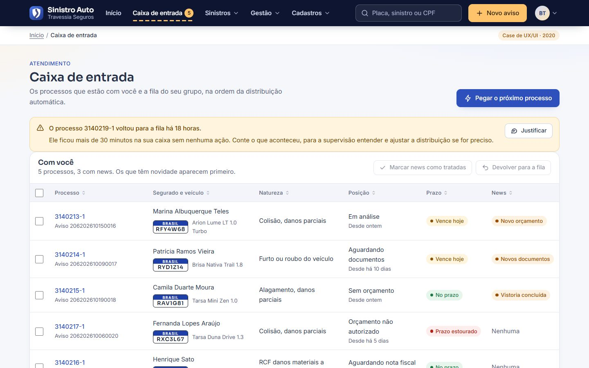 |

| Processo | Autorização de orçamento |
| --- | --- |
| 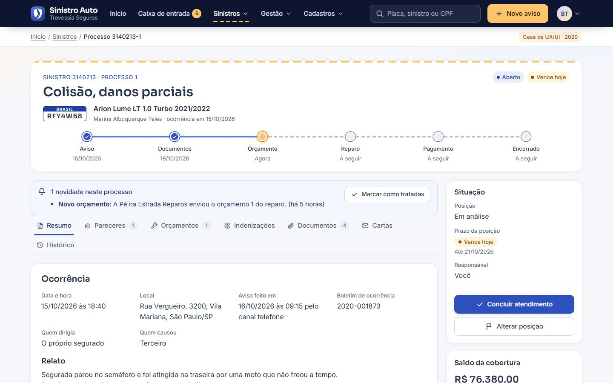 | 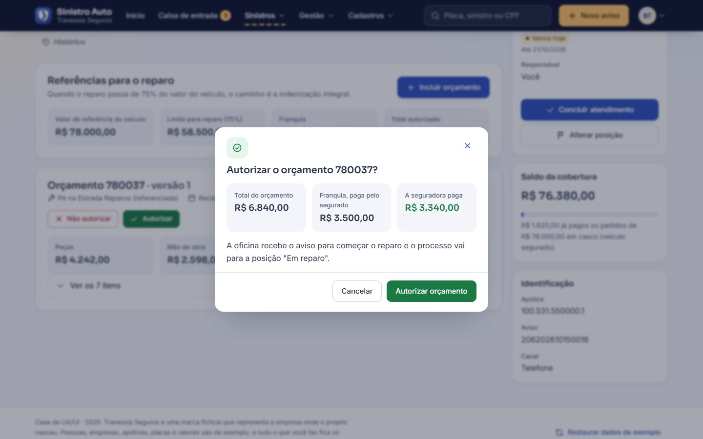 |

| Documentos | Carta |
| --- | --- |
| 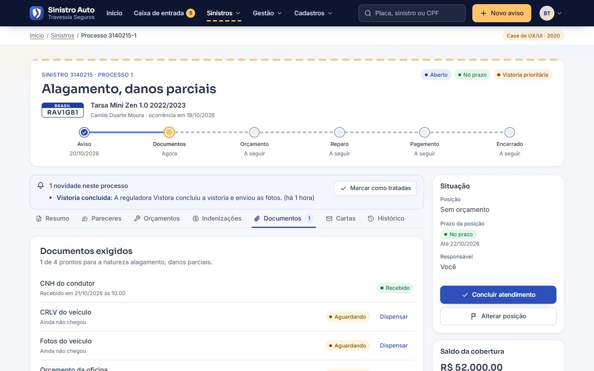 | 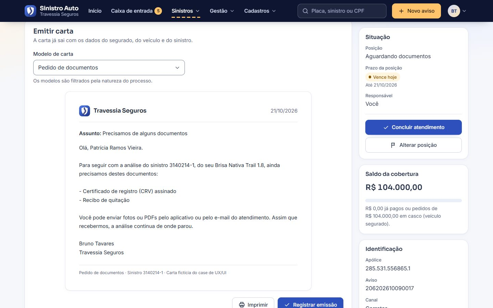 |

| Aviso com erros | Liberação de pagamentos |
| --- | --- |
| 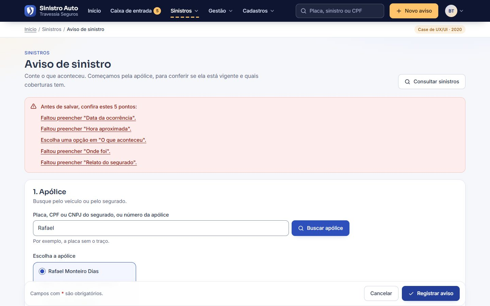 | 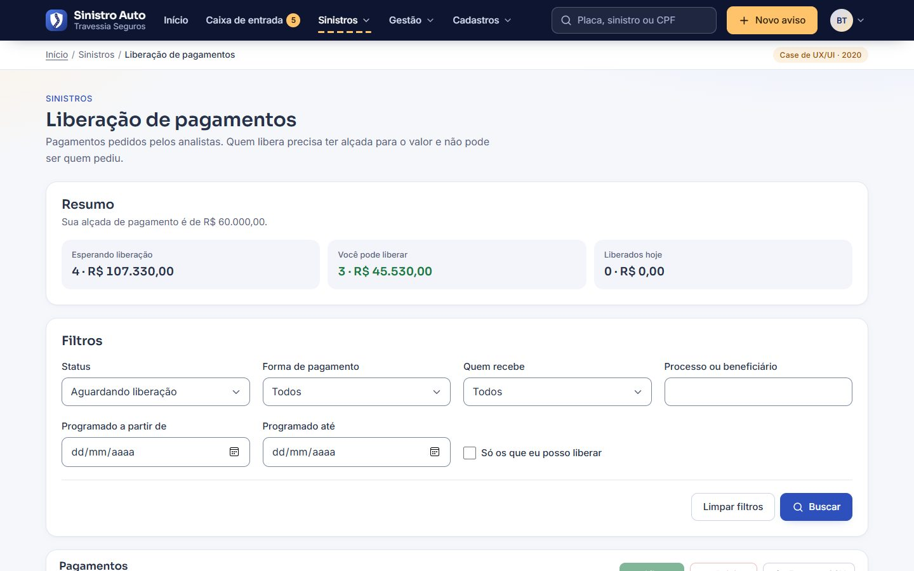 |

| Indicadores | Distribuição automática |
| --- | --- |
| 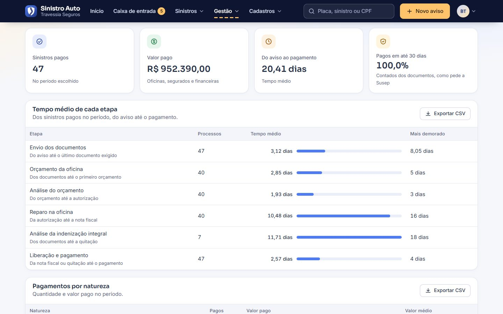 | 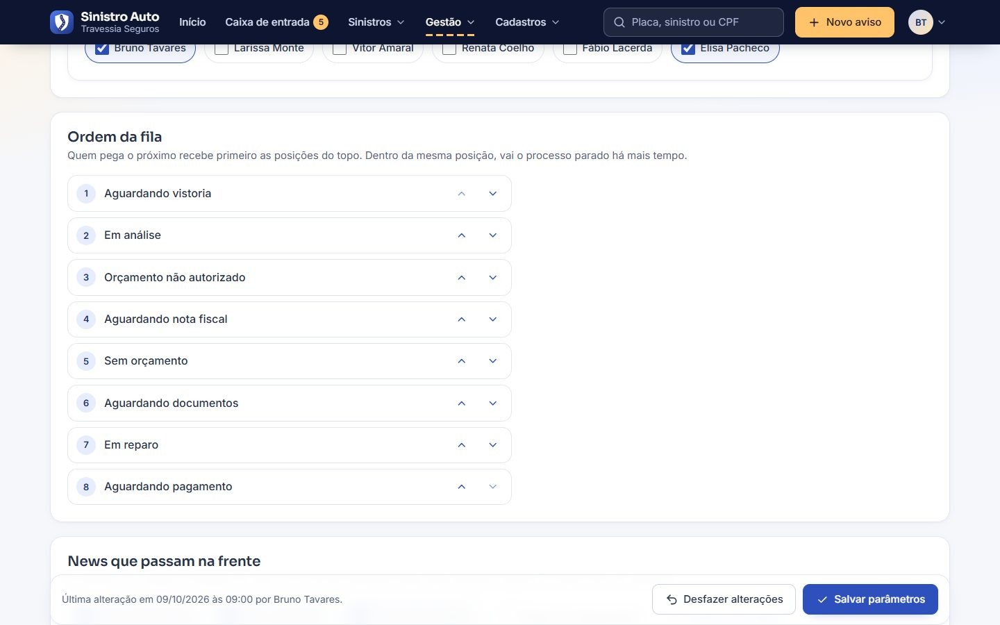 |

| Celular | Menu no celular |
| --- | --- |
| 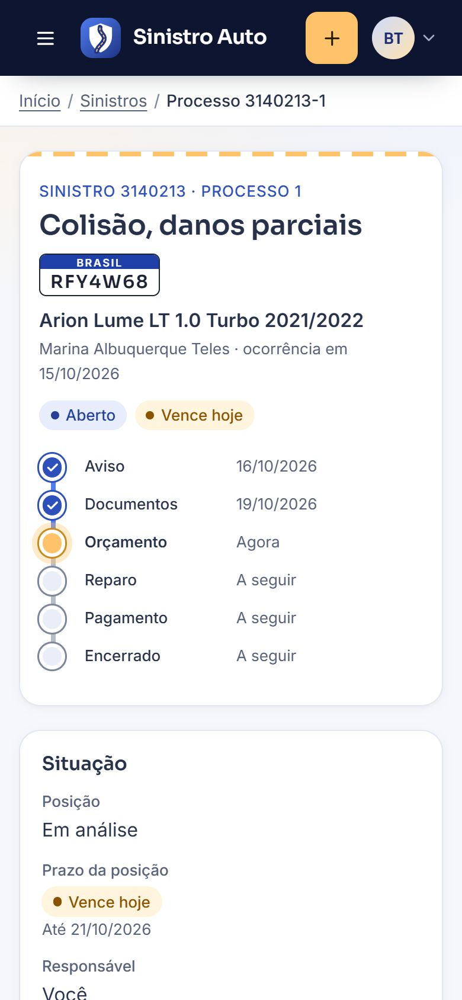 | 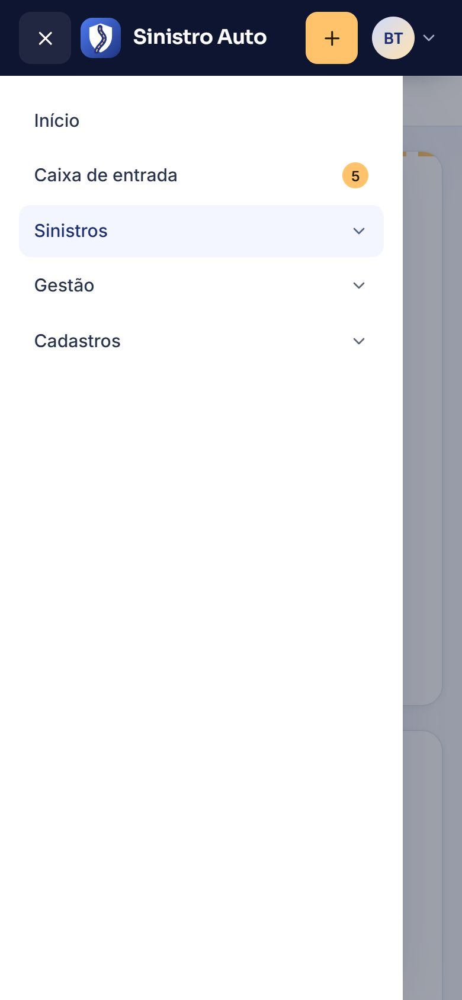 |

| Tela | Arquivo | O que faz |
| --- | --- | --- |
| Login | `login.html` | Matrícula e senha, com validação e botão de acesso de demonstração. Não há autenticação real. |
| Início | `inicio.html` | Caixa, fila, pagamentos para liberar, prazos estourados e o caminho de um sinistro. |
| Caixa de entrada | `caixa.html` | Processos com o analista, news, devolução para a fila, justificativa de processo parado e a fila do grupo na ordem da distribuição. |
| Consultar sinistros | `sinistros.html` | Busca por sinistro, aviso, placa, chassi, segurado ou documento, com filtros de natureza, posição, responsável, prazo e período. |
| Processo | `processo.html?id=...&aba=...` | Resumo, pareceres, orçamentos, indenizações, documentos, cartas e histórico. Alterar posição, concluir atendimento, assumir e reabrir. |
| Aviso de sinistro | `aviso.html` | Apólice, ocorrência, condutor, terceiro e contato. Abre o sinistro com um processo por cobertura. |
| Liberação de pagamentos | `pagamentos.html` | Liberar ou rejeitar em lote, dentro da alçada e nunca o próprio pedido. |
| Ressarcimentos | `ressarcimentos.html` | Cobrança do terceiro culpado, do acordo até o valor recebido. |
| Indicadores | `indicadores.html` | Tempo de cada etapa, pagamentos por natureza, processos por posição e por analista. |
| Distribuição automática | `distribuicao.html` | Grupos de análise, ordem da fila, news que passam na frente, prazo na caixa e prévia do próximo processo de cada pessoa. |
| Consultas | `consulta.html?tipo=...` | Uma tela para os 9 cadastros: oficinas, despachantes e reguladoras, financeiras e hospitais, modelos de carta, usuários, perfis, naturezas, posições e tipos de documento. |
| Cadastros | `cadastro.html?tipo=...&id=...` | Inclusão e edição com seções, endereço, contatos, dados bancários, permissões, histórico e exclusão protegida. |

---

## O que funciona no protótipo

**Distribuição e caixa**
- "Pegar o próximo processo" segue a ordem configurada: news prioritárias, vistoria prioritária, posição e tempo parado.
- Processo distribuído e sem nenhuma ação depois do prazo da caixa volta para a fila e pede justificativa.
- News marcadas como tratadas em lote e devolução para a fila com motivo.
- Supervisor pode assumir um processo que está com outra pessoa ou na fila, e reabrir processos encerrados.

**Aviso de sinistro**
- Busca da apólice por placa, CPF, CNPJ, nome ou número, com aviso de apólice vencida, prêmio pendente e processos abertos.
- Data da ocorrência dentro da vigência, boletim obrigatório em furto e roubo, relato com tamanho mínimo e CPF validado.
- Alerta de aviso duplicado (mesma apólice e mesma data).
- Quando o segurado causou o acidente, abre também o processo de RCF para os danos do terceiro.

**Processo**
- Orçamento digitado item a item, com totais ao vivo e aviso quando passa de 75% do valor do veículo.
- Autorização bloqueada acima de 75%, abaixo da franquia, acima da alçada de análise ou sem saldo na cobertura.
- Pedido de pagamento só depois de um orçamento autorizado nos danos parciais, com sugestão de "orçamento autorizado menos franquia" e limite pelo saldo da cobertura.
- Checklist de documentos exigidos pela natureza, com dispensa justificada, anexo de arquivo e sugestão de mudar a posição quando tudo chega.
- Pareceres por categoria e tipo, com documentos associados, filtro e abrir ou fechar todos.
- Cartas montadas a partir dos modelos, com impressão só da carta.
- Encerrar exige pagamento quando é "com indenização" e é bloqueado com pagamento esperando liberação.

**Pagamentos e ressarcimentos**
- Liberação em lote dentro da alçada, nunca do próprio pedido. A rejeição gera uma news para quem pediu.
- Ao liberar um pagamento em que o terceiro foi o culpado, o ressarcimento é aberto sozinho.
- Ressarcimento com status, valor recebido, histórico e taxa de recuperação.

**Em todas as listas**
- Filtros lembrados durante a sessão, ordenação por coluna, paginação, exportação para CSV e versão para impressão.
- **Restaurar dados de exemplo**, no rodapé do menu, volta tudo ao estado original.

---

## Acessibilidade

O protótipo foi revisado para a **WCAG 2.2 nível AA** e verificado com o
[axe-core](https://github.com/dequelabs/axe-core) em todas as telas e estados, no desktop
e no celular, sem violações.

- **Estrutura**: landmarks, link para pular ao conteúdo, títulos em ordem e trilha de navegação com `aria-current`.
- **Formulários**: rótulo visível em todos os campos, dicas ligadas por `aria-describedby`, erro no próprio campo e num resumo no topo com links que levam ao campo.
- **Validação que não atrapalha**: depois da primeira tentativa, o erro some enquanto a pessoa corrige. Nada muda de lugar no momento em que ela sai do campo.
- **Tabelas**: legenda, cabeçalhos de linha e coluna, ordenação com `aria-sort` e anúncio, área rolável com foco de teclado e paginação nomeada.
- **Abas do processo** como links com `aria-current="page"`: cada aba tem endereço próprio e funciona com o voltar do navegador.
- **Gráficos** como tabelas: o valor aparece em texto e a barra é só reforço visual.
- **Ordem da fila** reordenada por botões de subir e descer, com anúncio da nova posição, sem depender de arrastar.
- **Diálogos** com `<dialog>` nativo: prendem o foco, fecham com Esc e devolvem o foco a quem abriu.
- **Menus da barra superior** no padrão disclosure: botão com `aria-expanded`, Esc fecha e devolve o foco, clique fora fecha.
- **Menu no celular** como gaveta modal: o conteúdo atrás fica `inert`, Esc fecha e o foco volta ao botão.
- **Jornada do sinistro** como lista ordenada com `aria-current="step"` na parada atual; no celular ela fica na vertical.
- **Anúncios** para leitores de tela em ações sem mudança de página: "2 pagamentos selecionados, total de R$ 10.120,00", "Em análise agora é a 1ª de 8 na fila".
- **Contraste** de pelo menos 4,5:1 em texto e 3:1 em bordas de campos, alvos de toque de 44 px, suporte a movimento reduzido e ao alto contraste do Windows.

---

## Tecnologias e arquitetura

- **HTML, CSS e JavaScript puros**, sem build, sem framework e sem bibliotecas de runtime.
- **Inter** e **Sora** via Google Fonts, em pesos leves.
- **Ícones** num sprite SVG próprio (`img/icons.svg`).

```text
.
├── index.html            Redireciona para o login
├── login.html            Login (escuro)
├── inicio.html           Painel
├── caixa.html            Caixa de entrada e fila
├── sinistros.html        Consulta de sinistros
├── processo.html         Processo com abas (?id=...&aba=...)
├── aviso.html            Aviso de sinistro
├── pagamentos.html       Liberação de pagamentos
├── ressarcimentos.html   Ressarcimentos
├── indicadores.html      Indicadores
├── distribuicao.html     Parâmetros da distribuição automática
├── consulta.html         Consulta genérica dos cadastros (?tipo=...)
├── cadastro.html         Cadastro genérico (?tipo=...&id=...)
├── css/app.css           Design system (tokens, componentes, login, impressão)
├── js/common.js          Estrutura, validação, máscaras, diálogos, tabela, CSV
├── js/data.js            Dados de exemplo, regras de negócio e esquemas dos cadastros
├── js/<página>.js        Comportamento de cada página
├── img/                  Símbolo, sprite de ícones e ilustração
└── docs/screenshots/     Capturas usadas neste README
```

**Regras de negócio num lugar só.** Saldo da cobertura, prazo da posição, ordem da fila,
documentos exigidos, alçada e abertura do sinistro ficam em `js/data.js`. As telas só
chamam essas funções.

**Cadastros guiados por esquema.** Os 9 cadastros usam as mesmas duas páginas. Cada um é
descrito em `js/data.js`: seções, campos (tipo, máscara, regras, campos condicionais),
filtros, colunas, regras de duplicidade e quando a exclusão é bloqueada.

**Dados.** O "banco" é um objeto JSON no `sessionStorage` (chave `gsre:db`), criado a partir
de um gerador determinístico na primeira visita. As datas são relativas ao dia de hoje, para
que prazos, vigências e indicadores façam sentido sempre que alguém abrir o protótipo.

---

## Como rodar localmente

O projeto é estático: basta servir a pasta com qualquer servidor HTTP. Prefira um servidor
ao `file://`, porque a CSP e o sprite de ícones se comportam de forma diferente com
arquivos locais.

```bash
git clone https://github.com/fernandopinhel/prototipo-GSRE.git
cd prototipo-GSRE

# Opção 1: Python
python3 -m http.server 8080

# Opção 2: Node
npx serve .
```

Depois, acesse <http://localhost:8080> e clique em **Usar o acesso de demonstração**.
O acesso de demonstração entra como Bruno Tavares, supervisor de sinistros, que está em
todos os grupos da distribuição e pode assumir processos de outras pessoas.

Para validar o HTML:

```bash
npx htmlhint@1 "*.html"
```

---

## Publicação no GitHub Pages

O site é publicado direto da branch `master` (**Settings → Pages → Deploy from a branch**,
pasta `/`). A cada merge na `master`, o GitHub atualiza o site em cerca de um minuto. O
arquivo `.nojekyll` faz o GitHub servir os arquivos como estão, sem processar com Jekyll.

Endereço: <https://fernandopinhel.github.io/prototipo-GSRE/>

---

## Segurança e privacidade

- **Nenhum dado sai do navegador.** Não há back-end. Sessão e dados ficam no `sessionStorage` e somem ao fechar a aba. Arquivos anexados não são lidos: guardamos só o nome e o tamanho.
- **Content Security Policy** em todas as páginas: `script-src 'self'`, `style-src` sem `'unsafe-inline'`, `object-src 'none'`, `base-uri 'self'` e `form-action 'self'`. Só o Google Fonts é liberado como origem externa.
- **Sem JavaScript nem CSS inline.** Nenhum `<script>` inline, handler `on*=` ou atributo `style=` no HTML; a CSP bloquearia se houvesse.
- **Sem injeção de HTML.** Os elementos são montados com `createElement` e `textContent`, nunca com `innerHTML`.
- **CSV seguro**: valores que começam com `=`, `+`, `-` ou `@` são neutralizados para não virarem fórmula no Excel.
- **Referrer Policy** `strict-origin-when-cross-origin` e `noindex` para buscadores.

O GitHub Pages não permite definir cabeçalhos HTTP, por isso a CSP vai em `<meta>` e
`frame-ancestors` não se aplica. Veja também o [SECURITY.md](SECURITY.md).

---

## Limitações

- É um **protótipo**: não há back-end, autenticação real nem integração com oficinas, reguladoras ou bancos.
- Os dados vivem só na aba do navegador. Outra aba ou outro navegador começa do zero.
- Os perfis de acesso são cadastrados, mas não restringem o que a pessoa de demonstração vê.
- O pagamento liberado vira "Pago" quando a data programada chega, sem banco de verdade.
- A marca Travessia Seguros e todos os dados são fictícios. O repositório **não tem licença de código aberto**.

---

## Próximos passos

- [ ] CI com HTMLHint, bloqueio de código inline, testes de fluxo (Playwright) e auditoria de acessibilidade (axe).
- [ ] Aplicar os perfis de acesso ao menu e às ações de cada tela.
- [ ] Mudança de natureza do processo, para o caminho de danos parciais para indenização integral.
- [ ] Salvados: recolha, avaliação e venda em leilão do veículo indenizado.
- [ ] Portal do segurado para acompanhar o sinistro e enviar documentos.

---

## Histórico

### 2026-10: Case revisitado

- Seguradora fictícia Travessia Seguros, com símbolo que une escudo e estrada, no lugar da marca do cliente original.
- Reescrita completa em HTML, CSS e JavaScript puros, com layout de central de sinistros: barra de operações, placa Mercosul, jornada do sinistro e ficha com coluna lateral.
- Fluxos funcionais de ponta a ponta: aviso, distribuição automática, processo com 7 abas, liberação de pagamentos, ressarcimentos, indicadores e 9 cadastros.
- Acessibilidade revisada para a WCAG 2.2 AA, verificada com axe.
- Saíram Bootstrap, jQuery, CKEditor, plugins, Font Awesome, as fontes e os ícones da marca original e cerca de 85 MB de arquivos.
- Publicação no GitHub Pages e `SECURITY.md`.

### 2020-04 a 2021-05: Versão original

Protótipo navegável criado na empresa onde o projeto nasceu, com Bootstrap e jQuery.

---

## Autor

**Fernando Pinhel**, Fullstack Designer (UX/UI, Design Systems e Front-end)
[fernandopinhel.com.br](https://fernandopinhel.com.br) · [GitHub](https://github.com/fernandopinhel)
